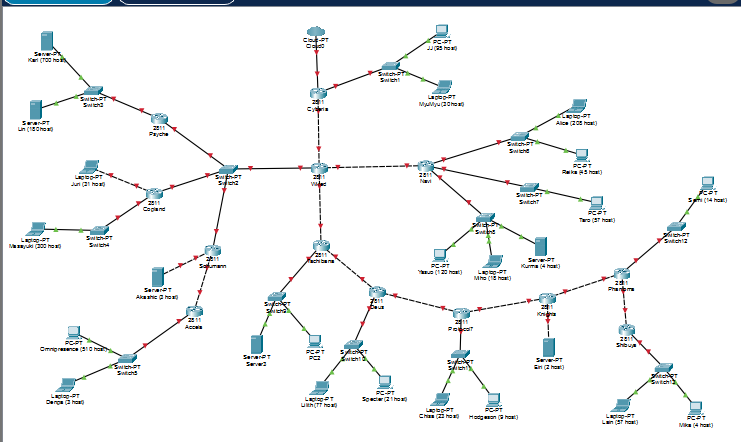
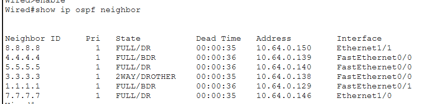
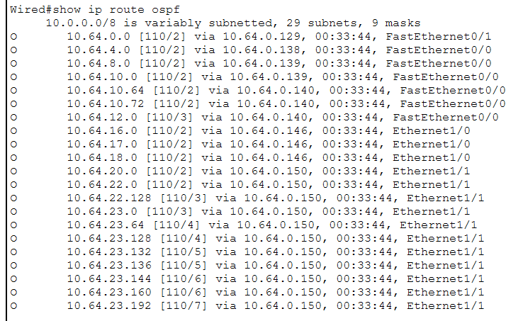
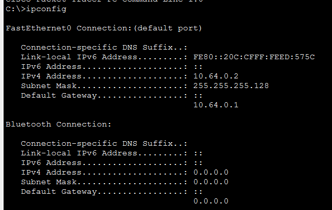
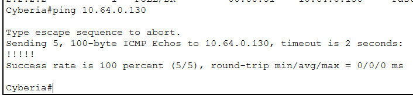
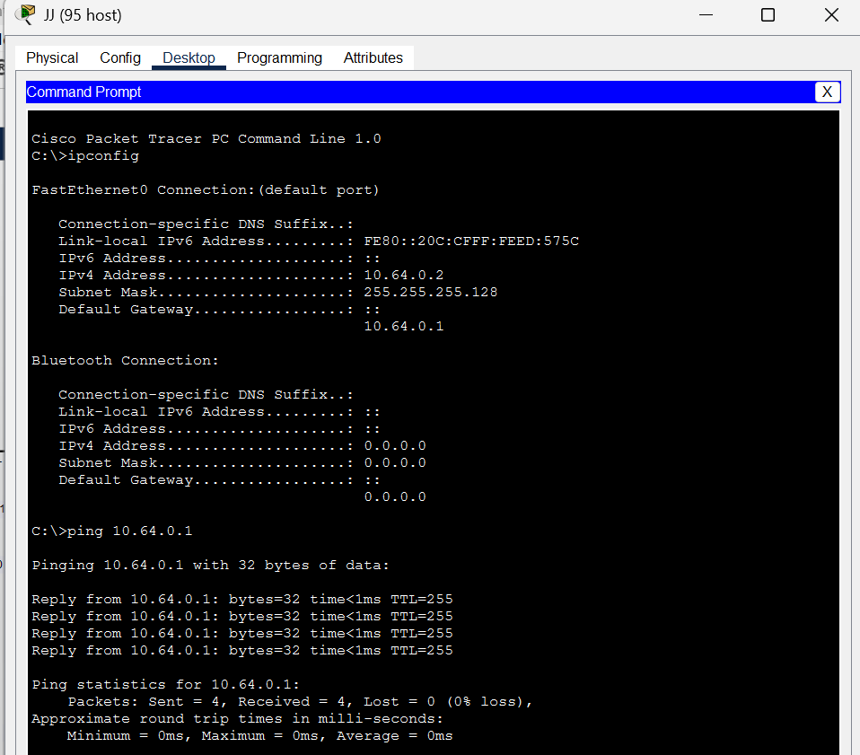
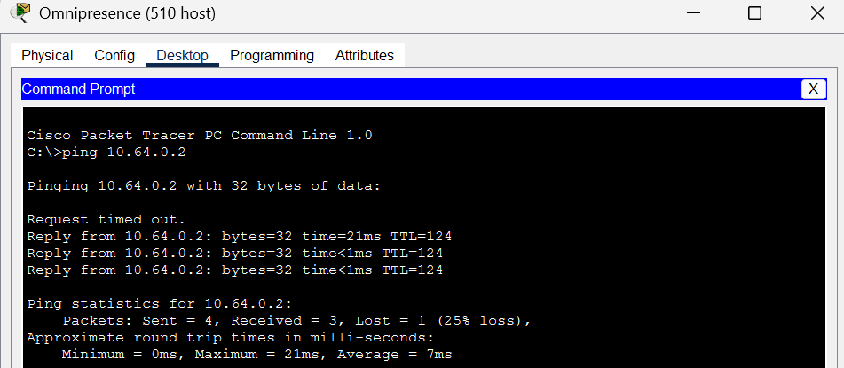
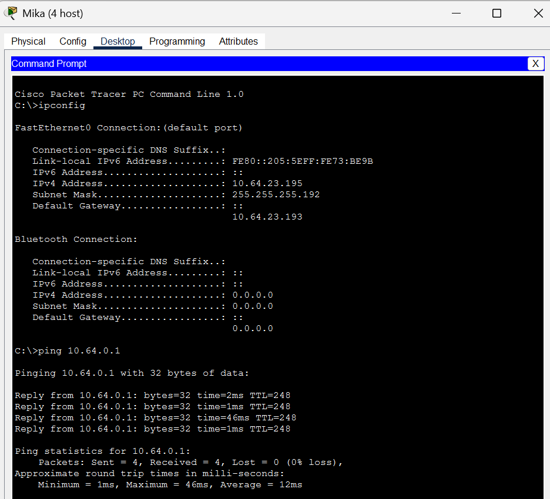

# Jarkom-Modul-4-2026-K-01

## Perancangan Alamat (VLSM)

Pengalamatan diurut dari subnet dengan kebutuhan host **terbesar ke terkecil**
agar tidak terjadi pemborosan maupun tumpang tindih blok.

| Subnet | Network ID | Prefix | Netmask | Broadcast | Rute | Jml IP |
|---|---|---|---|---|---|---|
| A1  | 10.64.0.0    | /25 | 255.255.255.128 | 10.64.0.127   | Cyberia › Switch1 › JJ, MyuMyu            | 126  |
| A2  | 10.64.0.128  | /30 | 255.255.255.252 | 10.64.0.131   | Cyberia › Wired                          | 2    |
| A3  | 10.64.0.136  | /29 | 255.255.255.248 | 10.64.0.143   | Wired › Switch2 › Psyche, Copland, Seelmann | 6 |
| A4  | 10.64.0.144  | /30 | 255.255.255.252 | 10.64.0.147   | Wired › Navi                             | 2    |
| A5  | 10.64.0.148  | /30 | 255.255.255.252 | 10.64.0.151   | Wired › Tachibana                        | 2    |
| A6  | 10.64.4.0    | /22 | 255.255.252.0   | 10.64.7.255   | Psyche › Switch3 › Karl, Lin             | 1022 |
| A7  | 10.64.8.0    | /23 | 255.255.254.0   | 10.64.9.255   | Copland › Switch4 › Masayuki             | 510  |
| A8  | 10.64.10.0   | /26 | 255.255.255.192 | 10.64.10.63   | Copland › Juri                           | 62   |
| A9  | 10.64.10.64  | /29 | 255.255.255.248 | 10.64.10.71   | Seelmann › Akashic                       | 6    |
| A10 | 10.64.10.72  | /30 | 255.255.255.252 | 10.64.10.75   | Seelmann › Accela                        | 2    |
| A11 | 10.64.12.0   | /22 | 255.255.252.0   | 10.64.15.255  | Accela › Switch5 › Omnipresence, Denpa   | 1022 |
| A12 | 10.64.16.0   | /24 | 255.255.255.0   | 10.64.16.255  | Navi › Switch6 › Alice, Reika            | 254  |
| A13 | 10.64.17.0   | /26 | 255.255.255.192 | 10.64.17.63   | Navi › Switch7 › Taro                    | 62   |
| A14 | 10.64.18.0   | /24 | 255.255.255.0   | 10.64.18.255  | Navi › Switch8 › Yasuo, Miho, Kuma       | 254  |
| A15 | 10.64.20.0   | /23 | 255.255.254.0   | 10.64.21.255  | Tachibana › Switch9 › Collective, Ghost  | 510  |
| A16 | 10.64.22.0   | /30 | 255.255.255.252 | 10.64.22.3    | Tachibana › Deus                         | 2    |
| A17 | 10.64.22.128 | /25 | 255.255.255.128 | 10.64.22.255  | Deus › Switch10 › Lilith, Specter        | 126  |
| A18 | 10.64.23.0   | /30 | 255.255.255.252 | 10.64.23.3    | Deus › Protocol7                         | 2    |
| A19 | 10.64.23.64  | /26 | 255.255.255.192 | 10.64.23.127  | Protocol7 › Switch11 › Chisa, Hodgeson   | 62   |
| A20 | 10.64.23.128 | /30 | 255.255.255.252 | 10.64.23.131  | Protocol7 › Knights                      | 2    |
| A21 | 10.64.23.132 | /30 | 255.255.255.252 | 10.64.23.135  | Knights › Eiri                           | 2    |
| A22 | 10.64.23.136 | /30 | 255.255.255.252 | 10.64.23.139  | Knights › Phantoma                       | 2    |
| A23 | 10.64.23.144 | /28 | 255.255.255.240 | 10.64.23.159  | Phantoma › Switch12 › Semi               | 14   |
| A24 | 10.64.23.160 | /30 | 255.255.255.252 | 10.64.23.163  | Phantoma › Shibuya                       | 2    |
| A25 | 10.64.23.192 | /26 | 255.255.255.192 | 10.64.23.255  | Shibuya › Switch13 › Lain, Mika          | 62   |
| **Total** | | **/19** | | | | **4118** |

---

## Topologi Cisco Packet Tracer



Struktur jaringan berbentuk hierarki/pohon dengan **Cyberia** sebagai akar
(terhubung ke Cloud), bercabang melalui **Wired** ke tiga arah (Navi,
Tachibana, dan segmen Switch2), lalu menurun hingga **Shibuya** di ujung.

---

## Konfigurasi

### Routing — OSPF Area 0
Digunakan **OSPF single-area** karena mendukung VLSM (classless) dan
otomatis menyebarkan rute antar router tanpa perlu menulis rute statik satu
per satu. Contoh pada tiap router:

```
router ospf 1
 router-id X.X.X.X
 network 10.64.0.0 0.0.255.255 area 0
```

### DHCP per-LAN
Setiap router LAN menjalankan DHCP server agar host memperoleh IP otomatis.
Contoh (Shibuya):

```
ip dhcp excluded-address 10.64.23.193
ip dhcp pool LAN-A25
 network 10.64.23.192 255.255.255.192
 default-router 10.64.23.193
 dns-server 8.8.8.8
```

### NAT pada Cyberia
Sesuai ketentuan, hanya **Cyberia** yang terhubung ke Cloud. NAT overload
(PAT) menerjemahkan seluruh 10.64.0.0/19 ke satu alamat publik:

```
access-list 1 permit 10.64.0.0 0.0.255.255
ip nat inside source list 1 interface FastEthernet0/0 overload
ip route 0.0.0.0 0.0.0.0 FastEthernet0/0
```

### Host statik
Semua PC/server memakai **DHCP**, kecuali **Eiri** (berada pada link /30
tanpa DHCP): IP `10.64.23.134`, netmask `255.255.255.252`, gateway
`10.64.23.133`.

---

## Pengujian

### Verifikasi Routing
>`show ip ospf neighbor` pada salah satu router (mis. Wired).
> Semua tetangga harus berstatus **FULL**.



> `show ip route ospf` pada router yang sama.
> Harus muncul banyak rute berkode **O** ke subnet-subnet lain.



### Verifikasi DHCP
>`ipconfig` pada sebuah PC, menunjukkan IP, subnet
> mask, dan gateway yang diperoleh otomatis dari DHCP.



### Pengujian Konektivitas (Ping)
>Ping antar router bersebelahan (uji link langsung),
> contoh dari Cyberia: `ping 10.64.0.130` (Wired).



> Ping PC ke gateway-nya sendiri (uji LAN lokal).



>  Ping PC ke PC pada subnet berbeda (uji routing
> antar-cabang): **Omnipresence** (subnet A11, `10.64.12.x`) →
> **JJ** (subnet A1, `10.64.0.2`). Paket pertama *Request timed out*
> karena proses ARP, paket berikutnya **Reply** — ini wajar di Packet Tracer.



> Ping ujung-ke-ujung terjauh: **Mika** (di Shibuya,
> ujung jaringan, `10.64.23.195`) → **10.64.0.1** (gateway LAN di Cyberia,
> sisi akar). TTL=248 menunjukkan paket melewati banyak router. Ini
> membuktikan seluruh jaringan saling terhubung dari ujung ke ujung.



### Tabel Hasil Pengujian

| No | Sumber | Tujuan | Hasil |
|---|---|---|---|
| 1 | Router Cyberia | Wired (10.64.0.130) | **100% (5/5) Reply** |
| 2 | PC JJ | Gateway 10.64.0.1 | **100% (4/4) Reply** |
| 3 | PC Omnipresence | PC JJ (10.64.0.2) | **Reply** (paket ke-1 timeout karena ARP) |
| 4 | PC Mika (Shibuya) | 10.64.0.1 (Cyberia) | **100% (4/4) Reply, TTL=248** |

Seluruh pengujian berhasil. Konektivitas end-to-end (dari Mika di ujung
Shibuya sampai gateway Cyberia) terbukti, sehingga seluruh subnet pada
jaringan 10.64.0.0/19 saling terhubung dengan benar.

---


## Lampiran
- Konfigurasi lengkap tiap router: folder `cpt/` (file `.cfg`).
- File simulasi Packet Tracer: folder `cpt/` (file `*.pkt`).