# JARKOM MODUL 4 2026 - K01

## Member

| Nama | NRP |
| --- | --- |
| Umar | 5027251005 |
| Syarifah Nailatur Rohma | 5027251109 |

## Laporan

### Topologi


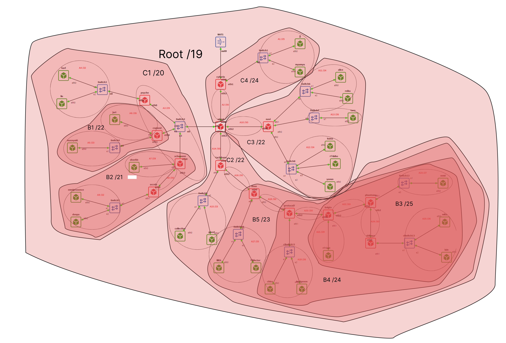

`Cyberia` berfungsi sebagai router utama yang menghubungkan seluruh jaringan The Wired menuju NAT/Cloud, sedangkan `Wired` bertindak sebagai hub distribusi pusat yang mencabang ke tiga arah: Navi, Tachibana, dan Switch2 (Psyche, Copland, Schumann, Accela). Prefix IP kelompok yang digunakan adalah `10.64.0.0/19`.

Sesuai ketentuan Modul 4, pengalamatan dan routing diimplementasikan menggunakan dua metode *classless addressing* yang berbeda:
1. **Cisco Packet Tracer (CPT)**: Menggunakan metode **VLSM (Variable Length Subnet Masking)** dipadukan dengan dynamic routing **OSPF Single-Area (Area 0)** dan DHCP server.
2. **GNS3**: Menggunakan metode **CIDR (Classless Inter-Domain Routing)** dengan agregasi subnet pohon hierarkis, static routing teragregasi (*summarized route*), dan skrip `/root/init.sh` pada kontainer Docker (`ardhptr21/debinet:latest` dan `ardhptr21/alpinet:latest`).

Daftar segmen jaringan dan kebutuhan host:

| Subnet | Jalur Segmen | Kebutuhan Host | Netmask | Jml IP |
|---|---|---|---|---|
| **A1** | Cyberia › Switch1 › JJ, MyuMyu | 100 host + 1 rtr | /25 | 128 |
| **A2** | Cyberia › Wired | 2 router | /30 | 4 |
| **A3** | Wired › Switch2 › Psyche, Copland, Schumann | 4 router | /29 | 8 |
| **A4** | Psyche › Switch3 › Karl, Lin | 880 host + 1 rtr | /22 | 1024 |
| **A5** | Copland › Switch4 › Masayuki | 300 host + 1 rtr | /23 | 512 |
| **A6** | Copland › Juri | 31 host + 1 rtr | /26 | 64 |
| **A7** | Schumann › Akashic | 3 host + 1 rtr | /29 | 8 |
| **A8** | Schumann › Accela | 2 router | /30 | 4 |
| **A9** | Accela › Switch5 › Omnipresence, Denpa | 513 host + 1 rtr | /22 | 1024 |
| **A10** | Wired › Navi | 2 router | /30 | 4 |
| **A11** | Navi › Switch6 › Alice, Reika | 253 host + 1 rtr | /24 | 256 |
| **A12** | Navi › Switch8 › Yasuo, Miho, Kuma | 142 host + 1 rtr | /24 | 256 |
| **A13** | Navi › Switch7 › Taro | 57 host + 1 rtr | /26 | 64 |
| **A14** | Wired › Tachibana | 2 router | /30 | 4 |
| **A15** | Tachibana › Switch9 › Collective, Ghost | 266 host + 1 rtr | /23 | 512 |
| **A16** | Tachibana › Deus | 2 router | /30 | 4 |
| **A17** | Deus › Switch10 › Lilith, Specter | 98 host + 1 rtr | /25 | 128 |
| **A18** | Deus › Protocol7 | 2 router | /30 | 4 |
| **A19** | Protocol7 › Switch11 › Chisa, Hodgeson | 32 host + 1 rtr | /26 | 64 |
| **A20** | Protocol7 › Knights | 2 router | /30 | 4 |
| **A21** | Knights › Eiri | 2 host + 1 rtr | /29 (CIDR) / /30 (CPT) | 8 / 4 |
| **A22** | Knights › Phantoma | 2 router | /30 | 4 |
| **A23** | Phantoma › Switch12 › Semi | 14 host + 1 rtr | /27 (CIDR) / /28 (CPT) | 32 / 16 |
| **A24** | Phantoma › Shibuya | 2 router | /30 | 4 |
| **A25** | Shibuya › Switch13 › Lain, Mika | 61 host + 1 rtr | /26 | 64 |

---

### 1. Perancangan Alamat dan Konfigurasi VLSM (Cisco Packet Tracer)

Pengalamatan VLSM diurutkan berdasarkan kebutuhan host dari **terbesar ke terkecil** untuk menghindari pemborosan ruang alamat IP.

#### Pembagian Alamat IP (VLSM)

| Subnet | Network ID | Prefix | Netmask | Broadcast | Range IP Valid | Rute / Segmen |
|---|---|---|---|---|---|---|
| **A1**  | 10.64.0.0    | /25 | 255.255.255.128 | 10.64.0.127   | 10.64.0.1 – 10.64.0.126   | Cyberia › Switch1 › JJ, MyuMyu |
| **A2**  | 10.64.0.128  | /30 | 255.255.255.252 | 10.64.0.131   | 10.64.0.129 – 10.64.0.130 | Cyberia › Wired |
| **A3**  | 10.64.0.136  | /29 | 255.255.255.248 | 10.64.0.143   | 10.64.0.137 – 10.64.0.142 | Wired › Switch2 › Psyche, Copland, Schumann |
| **A4**  | 10.64.0.144  | /30 | 255.255.255.252 | 10.64.0.147   | 10.64.0.145 – 10.64.0.146 | Wired › Navi |
| **A5**  | 10.64.0.148  | /30 | 255.255.255.252 | 10.64.0.151   | 10.64.0.149 – 10.64.0.150 | Wired › Tachibana |
| **A6**  | 10.64.4.0    | /22 | 255.255.252.0   | 10.64.7.255   | 10.64.4.1 – 10.64.7.254   | Psyche › Switch3 › Karl, Lin |
| **A7**  | 10.64.8.0    | /23 | 255.255.254.0   | 10.64.9.255   | 10.64.8.1 – 10.64.9.254   | Copland › Switch4 › Masayuki |
| **A8**  | 10.64.10.0   | /26 | 255.255.255.192 | 10.64.10.63   | 10.64.10.1 – 10.64.10.62   | Copland › Juri |
| **A9**  | 10.64.10.64  | /29 | 255.255.255.248 | 10.64.10.71   | 10.64.10.65 – 10.64.10.70 | Schumann › Akashic |
| **A10** | 10.64.10.72  | /30 | 255.255.255.252 | 10.64.10.75   | 10.64.10.73 – 10.64.10.74 | Schumann › Accela |
| **A11** | 10.64.12.0   | /22 | 255.255.252.0   | 10.64.15.255  | 10.64.12.1 – 10.64.15.254 | Accela › Switch5 › Omnipresence, Denpa |
| **A12** | 10.64.16.0   | /24 | 255.255.255.0   | 10.64.16.255  | 10.64.16.1 – 10.64.16.254 | Navi › Switch6 › Alice, Reika |
| **A13** | 10.64.17.0   | /26 | 255.255.255.192 | 10.64.17.63   | 10.64.17.1 – 10.64.17.62   | Navi › Switch7 › Taro |
| **A14** | 10.64.18.0   | /24 | 255.255.255.0   | 10.64.18.255  | 10.64.18.1 – 10.64.18.254 | Navi › Switch8 › Yasuo, Miho, Kuma |
| **A15** | 10.64.20.0   | /23 | 255.255.254.0   | 10.64.21.255  | 10.64.20.1 – 10.64.21.254 | Tachibana › Switch9 › Collective, Ghost |
| **A16** | 10.64.22.0   | /30 | 255.255.255.252 | 10.64.22.3    | 10.64.22.1 – 10.64.22.2   | Tachibana › Deus |
| **A17** | 10.64.22.128 | /25 | 255.255.255.128 | 10.64.22.255  | 10.64.22.129 – 10.64.22.254 | Deus › Switch10 › Lilith, Specter |
| **A18** | 10.64.23.0   | /30 | 255.255.255.252 | 10.64.23.3    | 10.64.23.1 – 10.64.23.2   | Deus › Protocol7 |
| **A19** | 10.64.23.64  | /26 | 255.255.255.192 | 10.64.23.127  | 10.64.23.65 – 10.64.23.126 | Protocol7 › Switch11 › Chisa, Hodgeson |
| **A20** | 10.64.23.128 | /30 | 255.255.255.252 | 10.64.23.131  | 10.64.23.129 – 10.64.23.130 | Protocol7 › Knights |
| **A21** | 10.64.23.132 | /30 | 255.255.255.252 | 10.64.23.135  | 10.64.23.133 – 10.64.23.134 | Knights › Eiri |
| **A22** | 10.64.23.136 | /30 | 255.255.255.252 | 10.64.23.139  | 10.64.23.137 – 10.64.23.138 | Knights › Phantoma |
| **A23** | 10.64.23.144 | /28 | 255.255.255.240 | 10.64.23.159  | 10.64.23.145 – 10.64.23.158 | Phantoma › Switch12 › Semi |
| **A24** | 10.64.23.160 | /30 | 255.255.255.252 | 10.64.23.163  | 10.64.23.161 – 10.64.23.162 | Phantoma › Shibuya |
| **A25** | 10.64.23.192 | /26 | 255.255.255.192 | 10.64.23.255  | 10.64.23.193 – 10.64.23.254 | Shibuya › Switch13 › Lain, Mika |

```mermaid
flowchart TD
    ROOT["10.64.0.0/19"] --> A6["A6: 10.64.4.0/22 (Karl, Lin)"]
    ROOT --> A11["A11: 10.64.12.0/22 (Omnipresence, Denpa)"]
    ROOT --> A7["A7: 10.64.8.0/23 (Masayuki)"]
    ROOT --> A15["A15: 10.64.20.0/23 (Collective, Ghost)"]
    ROOT --> A12["A12: 10.64.16.0/24 (Alice, Reika)"]
    ROOT --> A14["A14: 10.64.18.0/24 (Yasuo, Miho, Kuma)"]
    ROOT --> A1["A1: 10.64.0.0/25 (JJ, MyuMyu)"]
    ROOT --> A17["A17: 10.64.22.128/25 (Lilith, Specter)"]
    ROOT --> B26["Blok /26: A8, A13, A19, A25"]
    ROOT --> B28["Blok /28: A23"]
    ROOT --> B29["Blok /29: A3, A9"]
    ROOT --> B30["Blok /30: A2, A4, A5, A10, A16, A18, A20, A21, A22, A24"]
```

#### Konfigurasi Perangkat CPT

1. **Routing — OSPF Area 0**:
   Digunakan OSPF single-area pada seluruh router agar rute tersebar otomatis. Interface LAN diset passive.
   Contoh pada router `Cyberia` (`cpt/nodes/cyberia/init.cfg`):
   ```cisco
   router ospf 1
    router-id 1.1.1.1
    passive-interface FastEthernet0/1
    network 10.64.0.0 0.0.255.255 area 0
    default-information originate
   ```

2. **DHCP Server per-LAN**:
   Setiap router gateway LAN menjalankan DHCP server untuk host lokal.
   Contoh pada `Shibuya` (`cpt/nodes/shibuya/init.cfg`):
   ```cisco
   ip dhcp excluded-address 10.64.23.193
   ip dhcp pool LAN-A25
    network 10.64.23.192 255.255.255.192
    default-router 10.64.23.193
    dns-server 8.8.8.8
   ```

3. **NAT pada Cyberia**:
   Router Cyberia menjadi satu-satunya yang terhubung ke Cloud melalui NAT overload:
   ```cisco
   interface FastEthernet0/0
    description Uplink-NAT-Cloud
    ip address dhcp
    ip nat outside
    no shutdown
   !
   access-list 1 permit 10.64.0.0 0.0.255.255
   ip nat inside source list 1 interface FastEthernet0/0 overload
   ip route 0.0.0.0 0.0.0.0 FastEthernet0/0
   ```

4. **Host Statik Eiri**:
   Host Eiri dikonfigurasi statis pada link /30: IP `10.64.23.134`, netmask `255.255.255.252`, gateway `10.64.23.133`.

#### Pengujian CPT

- **Verifikasi OSPF Neighbor pada Wired (`show ip ospf neighbor`)**:


Tetangga OSPF berstatus FULL, menandakan database link-state berhasil disinkronisasi.

- **Verifikasi Tabel Rute OSPF (`show ip route ospf`)**:


Seluruh rute berkode `O` terdistribusi otomatis ke tabel routing.

- **Verifikasi DHCP Client pada PC (`ipconfig`)**:


PC klien berhasil memperoleh IP, subnet mask, dan gateway dari pool DHCP.

- **Ping Router ke Router (Cyberia → Wired `10.64.0.130`)**:


Konektivitas link point-to-point /30 berhasil (5/5 reply).

- **Ping PC ke Gateway Lokal**:


PC berhasil menjangkau interface LAN gateway lokal.

- **Ping Antar Subnet Lintas Cabang (Omnipresence `10.64.12.x` → JJ `10.64.0.2`)**:


Paket pertama timeout karena proses ARP, dilanjutkan reply sukses.

- **Ping Terjauh End-to-End (Mika di Shibuya → Gateway Cyberia `10.64.0.1`)**:


Reply 100% dengan TTL=248 membuktikan konektivitas menyeluruh dari ujung ke ujung.

| No | Sumber | Tujuan | Hasil |
|---|---|---|---|
| 1 | Router Cyberia | Wired (10.64.0.130) | **100% (5/5) Reply** |
| 2 | PC JJ | Gateway 10.64.0.1 | **100% (4/4) Reply** |
| 3 | PC Omnipresence | PC JJ (10.64.0.2) | **Reply (ARP init)** |
| 4 | PC Mika (Shibuya) | 10.64.0.1 (Cyberia) | **100% (4/4) Reply, TTL=248** |

---

### 2. Perancangan Alamat dan Konfigurasi CIDR (GNS3)

Metode CIDR dirancang berbasis **pohon hierarki agregasi rute (topological route aggregation)**. Subnet dikelompokkan secara bertahap dari daun (*edge*) menuju *core hub* agar tabel routing pada router perantara dapat diringkas (*route summarization*).

#### Penggabungan Subnet (CIDR Aggregation)

Berdasarkan lembar kerja spreadsheet `K-01 Modul 4 Komdat Jarkom 2026.xlsx`:

**Tahap I (Tingkat Cabang B)**:
- **B1**: A5 (/23) + A6 (/26) → Netmask **/22** (1024 IP)
- **B2**: A9 (/22) + A7 (/29) + A8 (/30) → Netmask **/21** (2048 IP)
- **B3**: A25 (/26) + A23 (/27) + A24 (/30) → Netmask **/25** (128 IP)
- **B4**: B3 (/25) + A21 (/29) + A22 (/30) → Netmask **/24** (256 IP)
- **B5**: A17 (/25) + A19 (/26) + A18 (/30) + A20 (/30) → Netmask **/23** (512 IP)

**Tahap II (Tingkat Regional C)**:
- **C1** (Cabang Barat): B1 (/22) + B2 (/21) + A4 (/22) + A3 (/29) → Netmask **/20** (4096 IP: `10.64.0.0/20`)
- **C2** (Cabang Tachibana): A15 (/23) + B5 (/23) + B4 (/24) + A14 (/30) + A16 (/30) → Netmask **/22** (1024 IP: `10.64.24.0/22`)
- **C3** (Cabang Navi): A11 (/24) + A12 (/24) + A13 (/26) + A10 (/30) → Netmask **/22** (1024 IP: `10.64.16.0/22`)
- **C4** (Cabang Cyberia): A1 (/25) + A2 (/30) → Netmask **/24** (256 IP: `10.64.20.0/24`)

**Tahap III (ROOT)**:
- **ROOT**: C1 (/20) + C2 (/22) + C3 (/22) + C4 (/24) → Netmask **/19** (`10.64.0.0/19`, 8192 IP)

```mermaid
flowchart TD
    ROOT["ROOT: 10.64.0.0/19"] --> C1["C1: 10.64.0.0/20"]
    ROOT --> C3["C3: 10.64.16.0/22"]
    ROOT --> C4["C4: 10.64.20.0/24"]
    ROOT --> C2["C2: 10.64.24.0/22"]
    
    C1 --> A4["A4: 10.64.0.0/22 (Karl, Lin)"]
    C1 --> B2["B2: 10.64.4.0/21"]
    C1 --> B1["B1: 10.64.12.0/22"]
    C1 --> A3["A3: 10.64.14.64/29 (Switch2)"]
    
    B2 --> A9["A9: 10.64.4.0/22 (Omnipresence, Denpa)"]
    B2 --> A7["A7: 10.64.8.0/29 (Akashic)"]
    B2 --> A8["A8: 10.64.8.8/30 (Schumann-Accela)"]
    
    B1 --> A5["A5: 10.64.12.0/23 (Masayuki)"]
    B1 --> A6["A6: 10.64.14.0/26 (Juri)"]
    
    C3 --> A11["A11: 10.64.16.0/24 (Alice, Reika)"]
    C3 --> A12["A12: 10.64.17.0/24 (Yasuo, Miho, Kuma)"]
    C3 --> A13["A13: 10.64.18.0/26 (Taro)"]
    C3 --> A10["A10: 10.64.18.64/30 (Wired-Navi)"]
    
    C4 --> A1["A1: 10.64.20.0/25 (JJ, MyuMyu)"]
    C4 --> A2["A2: 10.64.20.128/30 (Cyberia-Wired)"]
    
    C2 --> A15["A15: 10.64.24.0/23 (Collective, Ghost)"]
    C2 --> B5["B5: 10.64.26.0/23"]
    C2 --> B4["B4: 10.64.27.0/24"]
    C2 --> A14["A14: 10.64.27.140/30 (Wired-Tachibana)"]
    C2 --> A16["A16: 10.64.27.144/30 (Tachibana-Deus)"]
    
    B5 --> A17["A17: 10.64.26.0/25 (Lilith, Specter)"]
    B5 --> A18["A18: 10.64.26.128/30 (Deus-Protocol7)"]
    B5 --> A20["A20: 10.64.26.132/30 (Protocol7-Knights)"]
    B5 --> A19["A19: 10.64.26.192/26 (Chisa, Hodgeson)"]
    
    B4 --> B3["B3: 10.64.27.0/25"]
    B4 --> A21["A21: 10.64.27.128/29 (Eiri)"]
    B4 --> A22["A22: 10.64.27.136/30 (Knights-Phantoma)"]
    
    B3 --> A25["A25: 10.64.27.0/26 (Lain, Mika)"]
    B3 --> A23["A23: 10.64.27.64/27 (Semi)"]
    B3 --> A24["A24: 10.64.27.96/30 (Phantoma-Shibuya)"]
```

#### Pembagian Alamat IP (CIDR)

| Subnet | Network ID | Netmask | Broadcast | Range IP Valid | Entitas & Hubungan Interface |
|---|---|---|---|---|---|
| **A1** | `10.64.20.0` | 255.255.255.128 (/25) | `10.64.20.127` | 10.64.20.1 – 10.64.20.126 | Cyberia eth1 (20.1), JJ (20.2), MyuMyu (20.3) |
| **A2** | `10.64.20.128` | 255.255.255.252 (/30) | `10.64.20.131` | 10.64.20.129 – 10.64.20.130 | Cyberia eth2 (20.129) ↔ Wired eth0 (20.130) |
| **A3** | `10.64.14.64` | 255.255.255.248 (/29) | `10.64.14.71` | 10.64.14.65 – 10.64.14.70 | Switch2: Wired (14.65), Psyche (14.66), Copland (14.67), Schumann (14.68) |
| **A4** | `10.64.0.0` | 255.255.252.0 (/22) | `10.64.3.255` | 10.64.0.1 – 10.64.3.254 | Psyche eth1 (0.1), Karl (0.2), Lin (0.3) |
| **A5** | `10.64.12.0` | 255.255.254.0 (/23) | `10.64.13.255` | 10.64.12.1 – 10.64.13.254 | Copland eth1 (12.1), Masayuki (12.2) |
| **A6** | `10.64.14.0` | 255.255.255.192 (/26) | `10.64.14.63` | 10.64.14.1 – 10.64.14.62 | Copland eth2 (14.1), Juri (14.2) |
| **A7** | `10.64.8.0` | 255.255.255.248 (/29) | `10.64.8.7` | 10.64.8.1 – 10.64.8.6 | Schumann eth1 (8.1), Akashic (8.2) |
| **A8** | `10.64.8.8` | 255.255.255.252 (/30) | `10.64.8.11` | 10.64.8.9 – 10.64.8.10 | Schumann eth2 (8.9) ↔ Accela eth0 (8.10) |
| **A9** | `10.64.4.0` | 255.255.252.0 (/22) | `10.64.7.255` | 10.64.4.1 – 10.64.7.254 | Accela eth1 (4.1), Omnipresence (4.2), Denpa (4.3) |
| **A10** | `10.64.18.64` | 255.255.255.252 (/30) | `10.64.18.67` | 10.64.18.65 – 10.64.18.66 | Wired eth2 (18.65) ↔ Navi eth0 (18.66) |
| **A11** | `10.64.16.0` | 255.255.255.0 (/24) | `10.64.16.255` | 10.64.16.1 – 10.64.16.254 | Navi eth1 (16.1), Alice (16.2), Reika (16.3) |
| **A12** | `10.64.17.0` | 255.255.255.0 (/24) | `10.64.17.255` | 10.64.17.1 – 10.64.17.254 | Navi eth2 (17.1), Yasuo (17.2), Miho (17.3), Kuma (17.4) |
| **A13** | `10.64.18.0` | 255.255.255.192 (/26) | `10.64.18.63` | 10.64.18.1 – 10.64.18.62 | Navi eth3 (18.1), Taro (18.2) |
| **A14** | `10.64.27.140` | 255.255.255.252 (/30) | `10.64.27.143` | 10.64.27.141 – 10.64.27.142 | Wired eth3 (27.141) ↔ Tachibana eth0 (27.142) |
| **A15** | `10.64.24.0` | 255.255.254.0 (/23) | `10.64.25.255` | 10.64.24.1 – 10.64.25.254 | Tachibana eth1 (24.1), Collective (24.2), Ghost (24.3) |
| **A16** | `10.64.27.144` | 255.255.255.252 (/30) | `10.64.27.147` | 10.64.27.145 – 10.64.27.146 | Tachibana eth2 (27.145) ↔ Deus eth0 (27.146) |
| **A17** | `10.64.26.0` | 255.255.255.128 (/25) | `10.64.26.127` | 10.64.26.1 – 10.64.26.126 | Deus eth1 (26.1), Lilith (26.2), Specter (26.3) |
| **A18** | `10.64.26.128` | 255.255.255.252 (/30) | `10.64.26.131` | 10.64.26.129 – 10.64.26.130 | Deus eth2 (26.129) ↔ Protocol7 eth0 (26.130) |
| **A19** | `10.64.26.192` | 255.255.255.192 (/26) | `10.64.26.255` | 10.64.26.193 – 10.64.26.254 | Protocol7 eth1 (26.193), Chisa (26.194), Hodgeson (26.195) |
| **A20** | `10.64.26.132` | 255.255.255.252 (/30) | `10.64.26.135` | 10.64.26.133 – 10.64.26.134 | Protocol7 eth2 (26.133) ↔ Knights eth0 (26.134) |
| **A21** | `10.64.27.128` | 255.255.255.248 (/29) | `10.64.27.135` | 10.64.27.129 – 10.64.27.134 | Knights eth1 (27.129), Eiri (27.130) |
| **A22** | `10.64.27.136` | 255.255.255.252 (/30) | `10.64.27.139` | 10.64.27.137 – 10.64.27.138 | Knights eth2 (27.137) ↔ Phantoma eth0 (27.138) |
| **A23** | `10.64.27.64` | 255.255.255.224 (/27) | `10.64.27.95` | 10.64.27.65 – 10.64.27.94 | Phantoma eth1 (27.65), Semi (27.66) |
| **A24** | `10.64.27.96` | 255.255.255.252 (/30) | `10.64.27.99` | 10.64.27.97 – 10.64.27.98 | Phantoma eth2 (27.97) ↔ Shibuya eth0 (27.98) |
| **A25** | `10.64.27.0` | 255.255.255.192 (/26) | `10.64.27.63` | 10.64.27.1 – 10.64.27.62 | Shibuya eth1 (27.1), Lain (27.2), Mika (27.3) |

#### Konfigurasi Node GNS3 (/root/init.sh)

1. **Router Utama Cyberia (`nodes/cyberia/init.sh`)**:
   Menghubungkan jaringan NAT ke The Wired, mengaktifkan IP forwarding, NAT Masquerade IPTables, serta satu rute ringkasan ke seluruh `10.64.0.0/19`:
   ```bash
   ip addr flush dev eth0 2>/dev/null; ip addr add 192.168.122.100/24 dev eth0; ip link set eth0 up
   ip addr flush dev eth1 2>/dev/null; ip addr add 10.64.20.1/25 dev eth1; ip link set eth1 up
   ip addr flush dev eth2 2>/dev/null; ip addr add 10.64.20.129/30 dev eth2; ip link set eth2 up

   sysctl -w net.ipv4.ip_forward=1

   iptables -t nat -A POSTROUTING -o eth0 -j MASQUERADE
   iptables -A FORWARD -m state --state ESTABLISHED,RELATED -j ACCEPT
   iptables -A FORWARD -s 10.64.0.0/19 -o eth0 -j ACCEPT
   iptables -A FORWARD -j ACCEPT

   ip route replace default via 192.168.122.1 dev eth0
   ip route replace 10.64.0.0/19 via 10.64.20.130
   ```

2. **Core Distributor Router Wired (`nodes/wired/init.sh`)**:
   Mendistribusikan lalu lintas ke seluruh cabang dengan rute teragregasi supernet:
   ```bash
   ip addr flush dev eth0 2>/dev/null; ip addr add 10.64.20.130/30 dev eth0; ip link set eth0 up
   ip addr flush dev eth1 2>/dev/null; ip addr add 10.64.14.65/29 dev eth1; ip link set eth1 up
   ip addr flush dev eth2 2>/dev/null; ip addr add 10.64.18.65/30 dev eth2; ip link set eth2 up
   ip addr flush dev eth3 2>/dev/null; ip addr add 10.64.27.141/30 dev eth3; ip link set eth3 up

   sysctl -w net.ipv4.ip_forward=1

   ip route replace default via 10.64.20.129
   ip route replace 10.64.0.0/22 via 10.64.14.66   # Psyche (A4)
   ip route replace 10.64.12.0/22 via 10.64.14.67  # Copland (B1: A5, A6)
   ip route replace 10.64.4.0/22 via 10.64.14.68   # Schumann -> Accela (A9)
   ip route replace 10.64.8.0/28 via 10.64.14.68   # Schumann (A7, A8)
   ip route replace 10.64.16.0/22 via 10.64.18.66  # Navi (C3: A10-A13)
   ip route replace 10.64.24.0/22 via 10.64.27.142 # Tachibana (C2: A14-A25)
   ```

3. **Router Berantai Tachibana Series**:
   Masing-masing router hanya meneruskan paket ke downstream menggunakan rute agregasi:
   - **Tachibana (`nodes/tachibana/init.sh`)**:
     `ip route replace default via 10.64.27.141`
     `ip route replace 10.64.26.0/23 via 10.64.27.146` (menuju Deus)
   - **Deus (`nodes/deus/init.sh`)**:
     `ip route replace default via 10.64.27.145`
     `ip route replace 10.64.26.128/25 via 10.64.26.130`
     `ip route replace 10.64.27.0/24 via 10.64.26.130` (ringkasan B4 ke Protocol7)
   - **Protocol7 (`nodes/protocol7/init.sh`)**:
     `ip route replace default via 10.64.26.129`
     `ip route replace 10.64.27.0/24 via 10.64.26.134` (ke Knights)
   - **Knights (`nodes/knights/init.sh`)**:
     `ip route replace default via 10.64.26.133`
     `ip route replace 10.64.27.0/25 via 10.64.27.138` (ringkasan B3 ke Phantoma)
   - **Phantoma (`nodes/phantoma/init.sh`)**:
     `ip route replace default via 10.64.27.137`
     `ip route replace 10.64.27.0/26 via 10.64.27.98` (A25 ke Shibuya)
   - **Shibuya (`nodes/shibuya/init.sh`)**:
     `ip route replace default via 10.64.27.97`

4. **Workstation Client (Lain - `nodes/lain/init.sh`)**:
   ```bash
   ip addr flush dev eth0 2>/dev/null
   ip addr add 10.64.27.2/26 dev eth0
   ip link set eth0 up
   ip route replace default via 10.64.27.1

   cat <<EOF > /etc/resolv.conf
   nameserver 192.168.122.1
   nameserver 8.8.8.8
   EOF
   ```

#### Pengujian GNS3

- **Verifikasi Tabel Routing Cyberia (`ip route`)**:

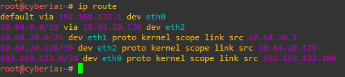

Hasil pengujian menunjukkan tabel routing Cyberia memiliki `default via 192.168.122.1` ke NAT dan 1 rute ringkasan `10.64.0.0/19 via 10.64.20.130` ke Wired.

- **Verifikasi Tabel Routing Teragregasi pada Wired (`ip route`)**:

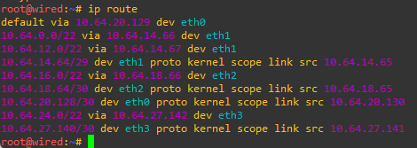

Wired hanya membutuhkan 6 rute supernet (/20, /21, /22) untuk menjangkau seluruh downstream The Wired.

- **Verifikasi Tabel Routing Rantai Tachibana / Deus (`ip route`)**:

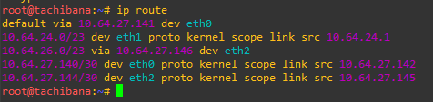

Tachibana dan Deus hanya menyimpan rute ringkasan blok hilir masing-masing.

- **Pengujian Ping Client ke Gateway Lokal (JJ ke Cyberia `10.64.20.1` & Lain ke Shibuya `10.64.27.1`)**:

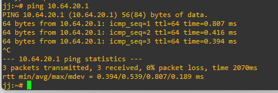

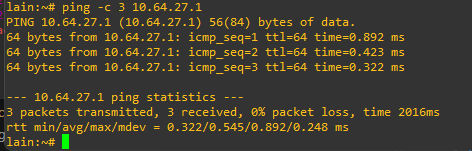

Hasil pengujian menunjukkan client berhasil terhubung langsung ke gateway lokal pada subnet masing-masing.

- **Pengujian Ping Antar-Subnet Lintas Cabang (karl `10.64.0.2` → JJ `10.64.20.2`)**:

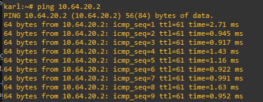

Paket berhasil melintasi router Psyce → Wired → Cyberia.

- **Pengujian Ping End-to-End Ekstrem (Lain di Shibuya → Gateway Cyberia `10.64.20.1`)**:

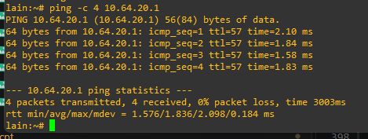

Lain di ujung terdalam topologi berhasil mencapai gateway akar Cyberia menembus 8 hop router.

- **Pengujian Ping Lintas Cabang Terdalam (Lain di Shibuya → Karl di Psyche `10.64.0.2`)**:

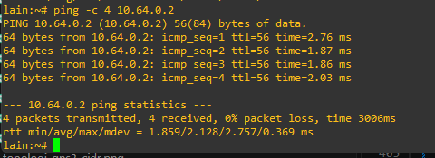

Konektivitas antar simpul daun pada cabang pohon yang berbeda berjalan lancar.

- **Pengujian Akses Internet / NAT Masquerade (Lain `10.64.27.2` → `8.8.8.8`)**:

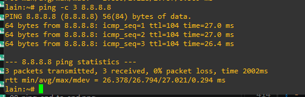

Simpul terdalam The Wired berhasil melakukan ping ke internet melalui NAT Masquerade Cyberia dengan 0% packet loss.

| No | Simpul Asal | Simpul Tujuan | Skenario Pengujian | Status |
|---|---|---|---|---|
| 1 | JJ (`10.64.20.2`) | Gateway Cyberia (`10.64.20.1`) | Intra-LAN Gateway | **Reply (0% loss)** |
| 2 | Cyberia (`10.64.20.129`) | Wired (`10.64.20.130`) | Link Router A2 | **Reply (0% loss)** |
| 3 | Karl (`10.64.0.2`) | Lin (`10.64.0.3`) | Intra-Subnet Switch3 | **Reply (0% loss)** |
| 4 | Masayuki (`10.64.12.2`) | Juri (`10.64.14.2`) | Inter-Subnet Copland | **Reply (0% loss)** |
| 5 | Omnipresence (`10.64.4.2`) | JJ (`10.64.20.2`) | Cross-Branch Accela ke Cyberia | **Reply (0% loss)** |
| 6 | Lain (`10.64.27.2`) | Gateway Cyberia (`10.64.20.1`) | End-to-End Shibuya ke Cyberia | **Reply (0% loss)** |
| 7 | Lain (`10.64.27.2`) | Karl (`10.64.0.2`) | Cross-Branch Shibuya ke Psyche | **Reply (0% loss)** |
| 8 | Lain (`10.64.27.2`) | Public DNS (`8.8.8.8`) | Akses Internet via NAT Masquerade | **Reply (0% loss)** |

---

### 3. Analisis Perbandingan VLSM dan CIDR

| Parameter | VLSM (Cisco Packet Tracer) | CIDR (GNS3) |
|---|---|---|
| **Prinsip Alokasi** | Diurutkan dari kebutuhan host **terbesar ke terkecil** secara greedy. | Diurutkan berdasarkan **kedekatan topologi pohon hierarkis**. |
| **Karakteristik Routing** | Rute spesifik (/22, /23, /24, /25, /26, /28, /29, /30) disebarkan secara dinamis via OSPF. | Rute disederhanakan melalui agregasi supernet (/20, /21, /22) pada routing statis. |
| **Ukuran Tabel Rute di Transit** | Besar (Wired menyimpan 25 rute spesifik OSPF). | Minimalis (Cyberia cukup 1 rute ringkasan, Wired cukup 6 rute supernet). |
| **Pemanfaatan Kapasitas** | Sangat rapat terhadap kebutuhan host per subnet. | Memperhatikan keselarasan batas bit (*power-of-2 boundary*) untuk agregasi. |
| **Protokol Pendukung** | OSPFv2, EIGRP, RIPv2. | BGP (Internet Core), Hierarchical Static Routing. |
